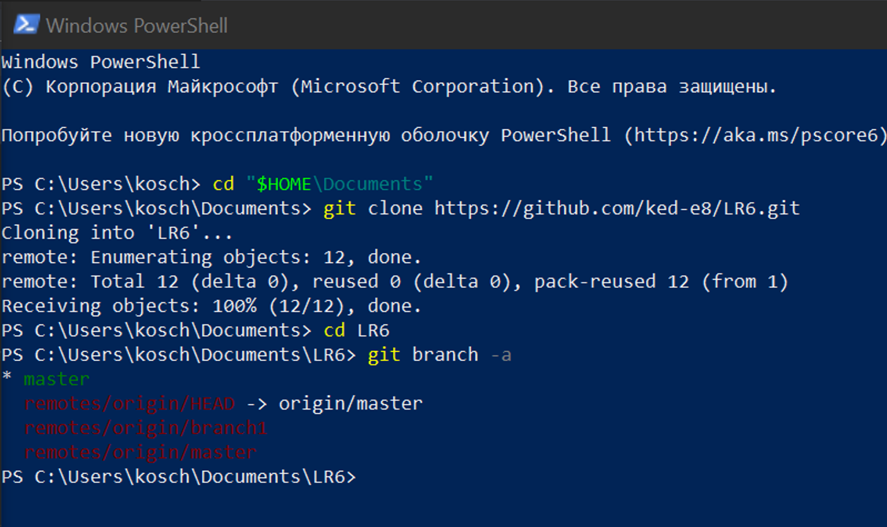
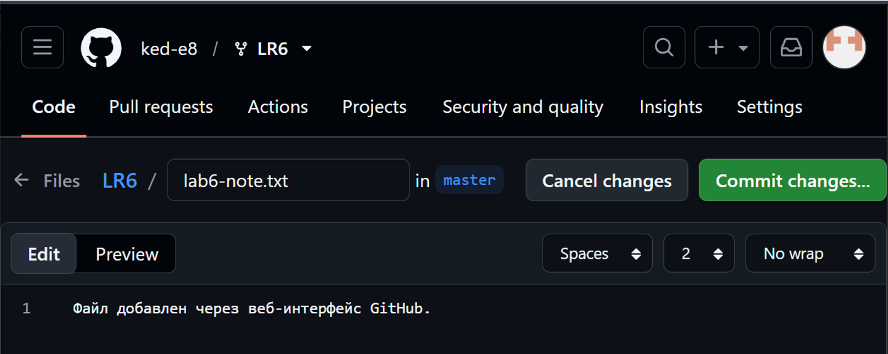
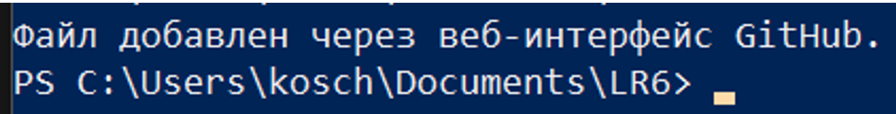
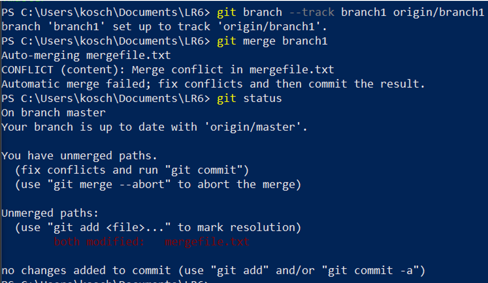
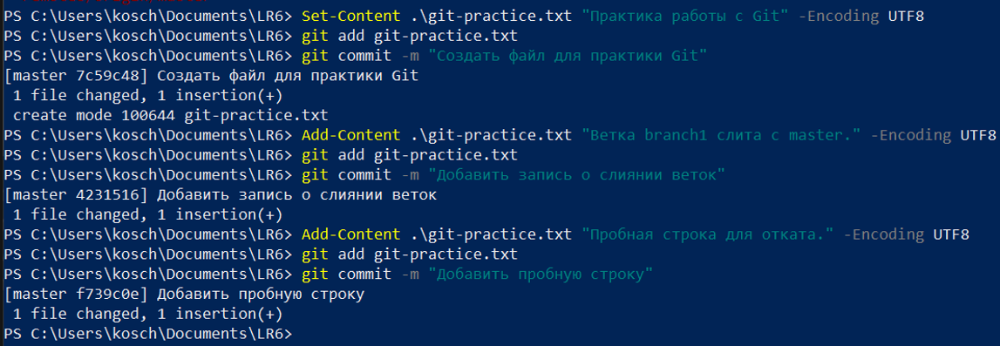

# Лабораторная работа №6. Система контроля версий

**Выполнил:** Кошин Е. Д., группа 4511в.

## Цель работы

Изучить базовые возможности Git и получить опыт работы с локальным и удалённым репозиториями.

## Подготовка репозитория

На GitHub создан форк репозитория Kurtyanik/LR6. Форк клонирован на компьютер. В локальном репозитории настроены имя и адрес автора коммитов. Через веб-интерфейс GitHub в ветку `master` добавлен файл `lab6-note.txt`. Изменение получено локально командой `git pull`.

## История веток и последние изменения

Командой `git log` просмотрена история веток `master` и `branch1`. Командой `git show` просмотрены их последние изменения.

## Слияние веток

При слиянии `branch1` с `master` возник конфликт в файле `mergefile.txt`. После разрешения конфликта результат слияния зафиксирован коммитом `60e4f3d`, а локальная ветка `branch1` удалена.

## Коммиты и откат

В ветке `master` сделаны три коммита с изменениями файла `git-practice.txt`. Затем командой `git revert` отменён коммит, добавивший пробную строку. В файле остались первые две строки.

