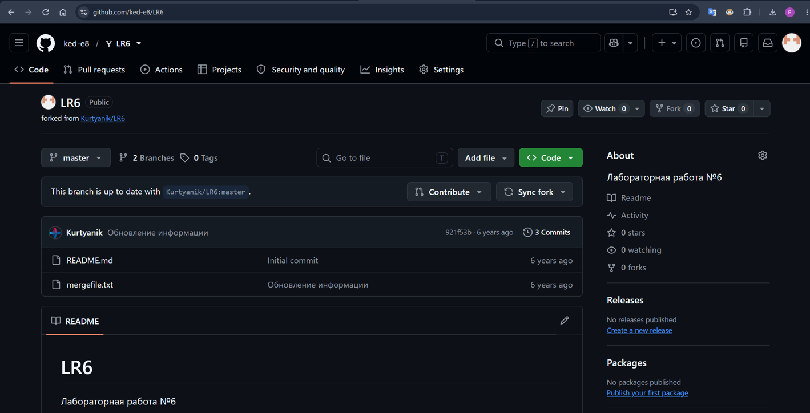
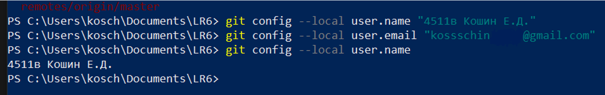
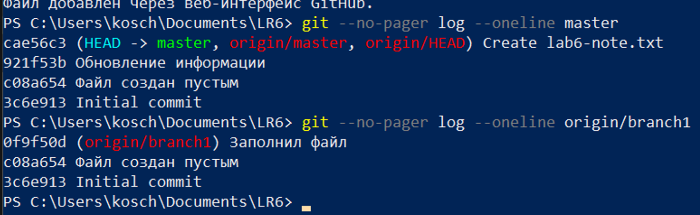
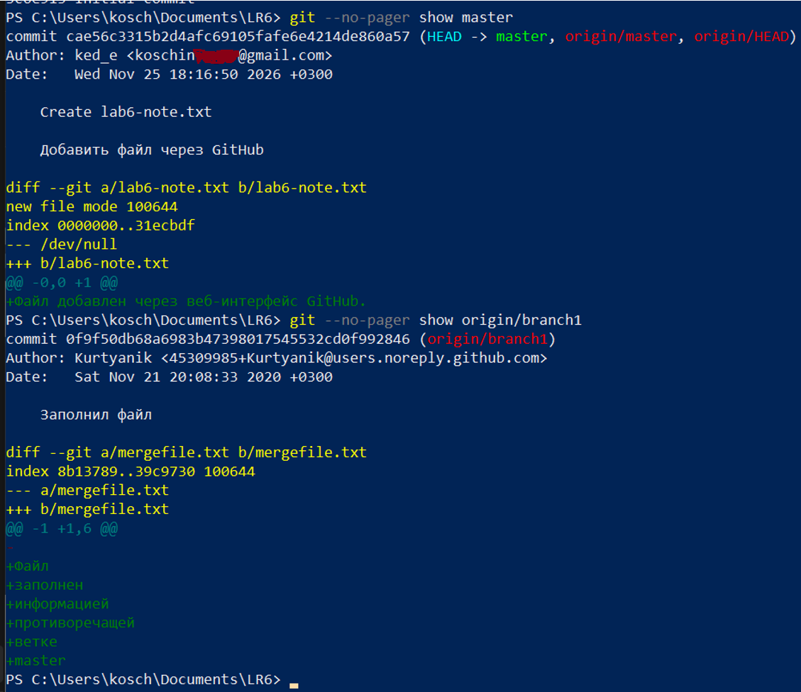
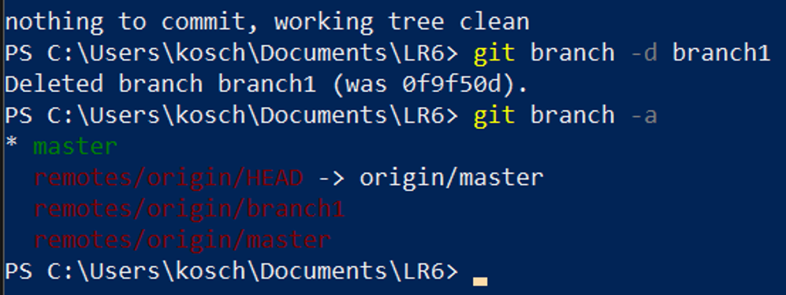
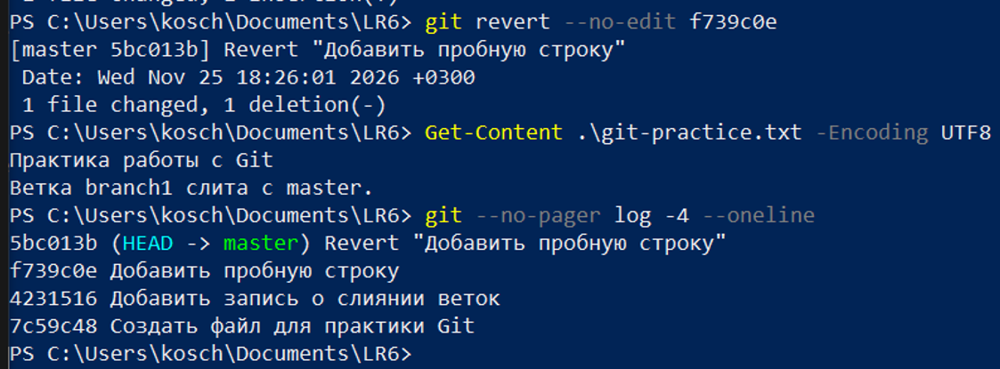

# Лабораторная работа №6. Система контроля версий

**Выполнил:** Кошин Е. Д., группа 4511в.

## Цель работы

Изучить базовые возможности Git и получить опыт работы с локальным и удалённым репозиториями.

## Подготовка репозитория

На GitHub создан форк репозитория Kurtyanik/LR6. Форк клонирован на компьютер. В локальном репозитории настроены имя и адрес автора коммитов. Через веб-интерфейс GitHub в ветку `master` добавлен файл `lab6-note.txt`. Изменение получено локально командой `git pull`.






## История веток и последние изменения

Командой `git log` просмотрена история веток `master` и `branch1`. Командой `git show` просмотрены их последние изменения.





## Слияние веток

При слиянии `branch1` с `master` возник конфликт в файле `mergefile.txt`. После разрешения конфликта результат слияния зафиксирован коммитом `60e4f3d`, а локальная ветка `branch1` удалена.




## Коммиты и откат

В ветке `master` сделаны три коммита с изменениями файла `git-practice.txt`. Затем командой `git revert` отменён коммит, добавивший пробную строку. В файле остались первые две строки.




## Лог команд

```powershell
cd "$HOME\Documents"
git clone https://github.com/ked-e8/LR6.git
cd LR6
git branch -a
git config --local user.name "4511в Кошин Е.Д."
git config --local user.email "<email>"
git config --local user.name
git pull
Get-Content .\lab6-note.txt -Encoding UTF8
git --no-pager log --oneline master
git --no-pager log --oneline origin/branch1
git --no-pager show master
git --no-pager show origin/branch1
git branch --track branch1 origin/branch1
git merge branch1
git status
notepad .\mergefile.txt
git add mergefile.txt
git commit -m "Слить branch1 с master и разрешить конфликт"
git status
git branch -d branch1
git branch -a
Set-Content .\git-practice.txt "Практика работы с Git" -Encoding UTF8
git add git-practice.txt
git commit -m "Создать файл для практики Git"
Add-Content .\git-practice.txt "Ветка branch1 слита с master." -Encoding UTF8
git add git-practice.txt
git commit -m "Добавить запись о слиянии веток"
Add-Content .\git-practice.txt "Пробная строка для отката." -Encoding UTF8
git add git-practice.txt
git commit -m "Добавить пробную строку"
git revert --no-edit f739c0e
Get-Content .\git-practice.txt -Encoding UTF8
git --no-pager log -4 --oneline
git switch -c report
git branch --show-current
git add README.md
git commit -m "Начать оформление отчёта по лабораторной №6"
git add README.md screenshots
git commit -m "Добавить описание работы с ветками и скриншоты"
git --no-pager log --reverse --date=short --format="%h | %ad | %an | %s"
```

## История коммитов

Короткий хэш, дата, автор и сообщение. История приведена на момент перед финальным коммитом отчёта.

```text
3c6e913 | 2020-11-21 | Kurtyanik | Initial commit
c08a654 | 2020-11-21 | Kurtyanik | Файл создан пустым
0f9f50d | 2020-11-21 | Kurtyanik | Заполнил файл
921f53b | 2020-11-21 | Kurtyanik | Обновление информации
cae56c3 | 2026-11-25 | ked_e | Create lab6-note.txt
60e4f3d | 2026-11-25 | 4511в Кошин Е.Д. | Слить branch1 с master и разрешить конфликт
7c59c48 | 2026-11-25 | 4511в Кошин Е.Д. | Создать файл для практики Git
4231516 | 2026-11-25 | 4511в Кошин Е.Д. | Добавить запись о слиянии веток
f739c0e | 2026-11-25 | 4511в Кошин Е.Д. | Добавить пробную строку
5bc013b | 2026-11-25 | 4511в Кошин Е.Д. | Revert "Добавить пробную строку"
018e0e1 | 2026-11-25 | 4511в Кошин Е.Д. | Начать оформление отчёта по лабораторной №6
19a24a9 | 2026-11-25 | 4511в Кошин Е.Д. | Добавить описание работы с ветками и скриншоты
```